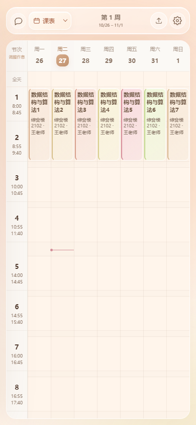
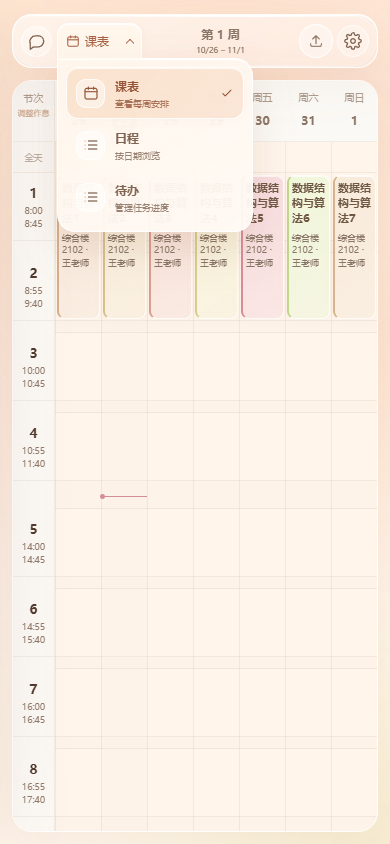
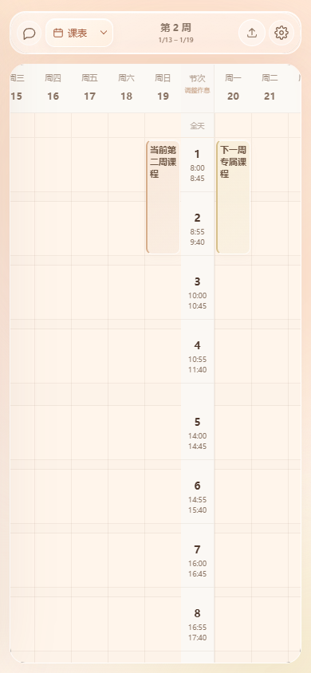

# 日程罗盘 · Schedule Copilot

把「作业、课表、比赛、考试」用一句话丢进对话框，直接渲染成看得懂的周课表、日程时间轴和待办清单。支持电脑本地版和安卓独立版，日程数据保存在运行设备上。



## 能干什么

- **对话即日程**：说「周五前交数据结构实验报告」「下周三晚七点蓝桥杯模拟赛」，模型自动换算日期、生成条目，右侧日历实时更新。
- **周课表**：按教学周渲染，支持单双周、跳周，今天高亮，当前时间红线。
- **液态玻璃界面**：使用 `liquid-glass-react`，明亮的奶油白、浅杏与珊瑚暖色，搭配浮动面板、折射边缘和胶囊导航；课表、对话、弹窗和移动端统一设计。支持减少动态效果和无背景模糊时的回退。
- **自定义作息**：课表左侧按节次显示时间段（如 `8:00～8:45`），点击时间段或「调整作息」即可单独修改起止时间、增删节次；设置中也可编辑。午休和课间压缩显示，按节次排的课程随新作息调整，自定义时段课程保持原时间。
- **批量调整时间**：作息编辑器支持「固定每节课时长」和「自动顺延后续节次」两个独立开关。统一填写课时分钟数后自动计算下课时间；开启顺延时，修改一节会一起移动后续节次，保留原有课间、午休间隔。开关状态随作息保存。
- **安卓临近提醒**：任务临近时发送系统通知，可选顶部胶囊悬浮窗（类似流动岛）；支持提前 5 / 10 / 15 / 30 / 60 分钟提醒。安卓独立版直接读取手机任务，用本地闹钟离线调度。[安装与权限说明](docs/android-reminders.md)
- **日程 / 待办**：未来 14 天时间轴；作业、比赛、考试分类，逾期标红，一键完成。
- **教务系统导入**：粘贴课表文字 / 抓取教务系统页面（Cookie）/ 导入 .ics，三种方式。
- **导出 ICS**：课程按周展开成重复事件，导进手机日历、Apple 日历、Google 日历。
- **本地优先**：课程和待办存在 `data/state.json`，API Key 存在 `data/settings.json`。除了你配置的模型接口，不发任何请求。

### 界面




## 快速开始

需要 Node.js 20+（开发时用的 24）。

```bash
cd schedule-copilot
npm install

# 开发模式（前端 5173 + 后端 8787，自动代理 /api）
npm run dev

# 或者生产模式：先构建，再起一个端口
npm run build
npm start          # http://127.0.0.1:8787
```

Windows 下也可以直接双击 `启动.bat`：自动装依赖、构建、起服务并打开浏览器。

## 安卓 APK

安装包：运行下方构建命令生成 `ScheduleCopilot.apk`（0.6.4 手机独立版，Android 7.0+，需较新的 Android System WebView，调试签名）。

- 页面、样式和新图标随 APK 一起安装；无需电脑服务或同一 Wi-Fi。
- 课表、待办、作息和本地规则对话离线可用，数据原子写入 App 私有目录，重启和覆盖安装后保留。
- AI 由手机直接调用设置里的 HTTPS OpenAI 兼容接口；请在手机配置 Base URL、模型名和 API Key，联网后使用。`127.0.0.1` 指手机自身，电脑版 Ollama 地址不适用于手机独立版。
- 设置 → 数据 → 导出完整备份 / 恢复备份可迁移 JSON 数据，不含 API Key。导出 ICS 可导入其它日历。卸载或清除 App 数据会删除私有文件，请先备份。
- UI 包含七天一屏、相邻周课表连续跟手拖动（拖动即预览真实下一周）、松手翻周、短距离和学期边界回弹（遵循系统减少动态效果设置）、单行工具栏、玻璃下拉菜单；已移除原生标题横幅。
- 设置 → 设置手机提醒中授予通知、悬浮窗、精确提醒权限，可离线调度临近任务。

安装：将 APK 传到手机并安装，同包名同签名可直接覆盖旧版。首次运行如果包内含初始日程，会自动迁移；之后升级不会覆盖手机已有数据。开源版本默认不附带任何个人日程或模型配置。

自行重打包：

```powershell
powershell -ExecutionPolicy Bypass -File scripts/setup-android.ps1
powershell -ExecutionPolicy Bypass -File scripts/build-apk.ps1
# 可选：-SeedStatePath path/to/state.json，仅在手机尚无本地数据时导入
```

构建脚本自动执行 `npm run build:mobile` 并把 `dist-mobile/` 放进 APK 的 `assets/web/`。前端通过受限原生桥接保存私有数据、导出文件和请求 HTTPS 模型接口；不运行远程网页。提醒读取手机本地任务，不再依赖网络同步。

验证：`npm run typecheck`、`npm test`、`npm run test:ui`、`npm run test:mobile`、`npm run test:android`。移动测试对已打包构建使用相同的页面 CSP 和桥接接口，模拟断网、持久存储、写入失败、备份与模型工具调用；不消耗真实模型额度。未连接安卓真机或模拟器，原生权限与浮窗请在手机上试发提醒验证。

### 第一次使用：接上模型

点右上角齿轮 → 模型 → 选一个预设（DeepSeek / 通义千问 / OpenAI / 本地 Ollama），填 API Key，点「测试连接」，保存。

- **DeepSeek**：`https://api.deepseek.com/v1` + `deepseek-chat`，国内直连、便宜，推荐。
- **本地 Ollama**：`http://127.0.0.1:11434/v1` + `qwen2.5:7b`，Key 随便填（服务端对 localhost 不校验 Key）。
- 任何 OpenAI 兼容的 `/chat/completions` 接口都能用，需要支持 function calling（工具调用）。

没配模型也能用：课表导入的规则解析、手动增删改、ICS 导出都不依赖模型，只是对话功能会提示先配置。

### 本地测试（不需要 API Key）

设置 → 模型 → 选「本地离线（不用 Key）」→ 保存。之后对话完全不联网、不花钱，靠内置规则解析：

```
明天下午三点前交高数作业      → 任务，明天 15:00
周五前交数据结构实验报告      → 任务，周五 23:59
下周三晚上七点蓝桥杯模拟赛    → 比赛，下周三 19:00
记一下，明晚八点写英语作文    → 任务，明天 20:00
这周还有什么没做完？          → 按天列出本周课程和待办
```

支持「今天/明天/后天/明晚/今晚/周X/下周X/10月30号」+「下午三点/晚上七点/八点半/20:00」，识别不出时会提示例子。修改、删除、复杂表述需要配置模型。

想换成真模型时，点任意服务商预设（DeepSeek 等）就会自动退出本地模式。

## 导入教务系统课表

点右上角「导入课表」，三种方式：

### 1. 粘贴文字（最通用）

把教务系统课表页全选复制，直接粘进去。整页复制也行，模型会自己挑课程；也可以按行写：

```
高等数学 周一 1-2节 1-16周 教三201
数据结构 周四 5-6节 1-16周 计算机楼402
篮球 周五 7-8节 2-16双周 东区体育馆
```

没配模型时会走内置规则解析，上面这种格式能直接认；格式太乱建议配模型。

### 2. 教务系统链接

填课表页地址 + 登录后的 Cookie，服务端抓页面解析：

1. 浏览器登录教务系统，打开课表页
2. F12 → Network → 刷新 → 找到课表那个请求
3. 复制请求头里的 `Cookie` 整行，粘进对话框

正方教务系统（新版 `kbList` JSON）会被直接识别；强智、青果等返回 HTML 表格的走表格解析。抓不到、要验证码、或者页面是前端渲染的，就用「粘贴文字」。

> 这里只读取你手动提供的页面，不会保存账号密码，也不会替你登录。Cookie 过期重新复制即可。

### 3. ICS 文件

支持 WakeUp 课程表、系统日历导出的 `.ics`。重复事件（RRULE）会转成课程；「每周一条」的导出也会按 标题+星期+时间 自动归并。

导入前记得填对「第 1 周周一」——它决定「第 5 周周三」是哪天。

## 对话能做什么

| 你说 | 它做 |
| --- | --- |
| 明天下午三点前交高数作业 | 建任务，截止明天 15:00，并关联「高等数学 A」 |
| 下周三晚上七点蓝桥杯模拟赛，线上 | 建比赛条目，带地点 |
| 这周还有什么没做完？ | 调用日程查询，按天列出来 |
| 把周五的英语课改到周四下午 | 改课程时间 |
| 记一下，10 月 30 号四级报名截止 | 建任务 |

相对时间由服务端把「当前时间 + 学期周次 + 作息表」一起塞给模型，模型只负责换算和填结构化参数；所有写入都过一遍 JSON 校验，坏参数不会落库。

## 导出到手机日历

右上角「导出」下载 `日程.ics`：

- 课程按 `[周次] × [星期]` 展开成独立事件，兼容性最好
- 作业/比赛带上 emoji 前缀，截止时间就是事件时间
- 用浮动本地时间（不写 UTC），并标注 `X-WR-TIMEZONE:Asia/Shanghai`

Apple 日历 / Google 日历 / 手机自带日历都能直接导入。

## 数据与技术栈

```
schedule-copilot/
├── server/            Express API
│   ├── agent.ts       OpenAI 兼容流式调用 + 工具调用循环
│   ├── tools.ts       add_items / update_items / remove_items / list_schedule / add_courses / set_term
│   ├── importers.ts   文本 / 教务系统 URL / ICS 解析（含正方 kbList）
│   ├── html.ts        轻量 HTML 表格解析
│   ├── ics.ts         ICS 导出
│   └── store.ts       本地 JSON 存储
├── src/               React 前端
│   ├── components/    WeekGrid / AgendaView / TodoView / ChatPanel / 各种弹窗
│   └── lib/           日期、周次、颜色
├── scripts/           本地验证脚本（mock 模型、UI 截图、ICS 往返）
└── data/              运行时生成：state.json / settings.json
```

技术栈：React 19 + Vite 8 + TypeScript · Express 5 · [node-ical](https://github.com/jens-maus/node-ical)（ICS 解析）· zod。没有用日历组件库——教务课表的「周次 + 单双周 + 节次」用 FullCalendar 反而绕，自己画网格更直接。

## 开发与自测

```bash
npm run typecheck          # tsc --noEmit
npm run build              # 构建前端到 dist/
npm test                   # 日期、导入导出、API、工具调用与聊天流回归检查
npm run test:ui            # 构建后运行 Chrome / Edge 界面回归检查
npm run test:android       # 使用本地 JDK 验证手机提醒的闹钟规划逻辑

# 不花 API 费用地验证对话链路：起一个假模型，再起两个脚本
node scripts/mock-llm.mjs          # 127.0.0.1:8899，返回固定工具调用
node scripts/serve-fixtures.mjs    # 127.0.0.1:8898，假的教务系统课表页
node scripts/ics-test.mjs          # 导出 -> 重新导入，检查课程/任务数量
node scripts/ui-check.mjs          # 用本机 Chrome 无头截图 + 抓控制台报错

# 安卓 APK（不用 Android Studio / Gradle）
powershell -ExecutionPolicy Bypass -File scripts/setup-android.ps1
powershell -ExecutionPolicy Bypass -File scripts/build-apk.ps1
```

`ui-check.mjs` 需要本机装了 Chrome（脚本里写死了 `C:/Program Files/Google/Chrome/Application/chrome.exe`，换路径即可），用 `playwright-core` 驱动，不下载浏览器。

新增的 `npm test` 和 `npm run test:ui` 使用临时数据目录、随机端口，不读取或覆盖 `data/`，也不调用真实模型。界面测试自动查找 Windows 上的 Chrome / Edge；其它安装位置可用环境变量 `SCHEDULE_BROWSER_PATH` 指定浏览器可执行文件。

近期修复说明见 [docs/bugfix-notes.md](docs/bugfix-notes.md)，包括日期与单双周、ICS 单次日程导入、编辑时清空时间、聊天断流，以及模型写入覆盖手动新增数据的问题。

## 已知限制

- 教务系统登录态靠 Cookie，过期要重新复制；验证码 / 动态令牌 / 纯前端渲染的教务系统抓不到，退回粘贴。
- 模型算相对时间偶尔会差一天，重要截止建议在界面上扫一眼，点开确认。
- 单用户本地工具，没有账号体系；同一份 `data/` 只能一个人用。
- ICS 导出把课程按周展开，16 周 × 4 门课 = 64 条事件，日历里看着多但最稳。
- APK 的课表界面依赖电脑服务；已缓存任务的提醒可离线调度。后台省电和强行停止可能影响同步与提醒，见[提醒说明](docs/android-reminders.md)。校园网客户端隔离时需换热点或虚拟局域网。

## 许可

MIT。用到的开源项目各遵循其原许可（React、Vite、Express、node-ical、Playwright）。
